# Architecture: Kanban Board Bases view

## Overview

Clár adds a custom [Bases](https://docs.obsidian.md/plugins/guides/bases-view) view type,
`clar-kanban` ("Kanban board"). It groups a base's already-filtered notes into columns
by the value of a chosen list-type frontmatter property, using
[SortableJS](https://sortablejs.github.io/Sortable/) as the foundation for future
drag-and-drop. This initial version only renders columns and cards — no drag-and-drop,
no style polish.

## Components

### `src/bases/register-kanban-view.ts`
Calls `Plugin.registerBasesView(KANBAN_VIEW_TYPE, { name, icon, factory, options })` from
`onload()`. The `factory` constructs a `KanbanBasesView`; `options` comes from
`kanban-view-options.ts`. Warns (doesn't throw) if registration returns `false`, which
means the core Bases plugin isn't enabled in the vault.

### `src/bases/kanban-view-options.ts`
Builds the two view-configuration controls exposed in the Bases toolbar, per the spec:
- **Column property** — a `BasesPropertyOption` ("property" dropdown) filtered via
  `isListProperty()` so only list-type frontmatter properties are selectable.
- **Column order** — a `BasesTextOption` for a comma-separated list defining column order.

There is **no custom "view name" option**. `BasesViewConfig.name` already gives every
Bases view (of any type) a user-editable name generically through Bases' own view
management UI, so the spec's "Name of the view" requirement is satisfied by the
platform, not by plugin code.

### `src/bases/property-type.ts`
`isListProperty(app, propertyId)` restricts the dropdown to `note.*` (frontmatter)
properties whose declared type is Obsidian's list type. Obsidian's public API has no
documented way to read a property's declared type, so this reaches into
`app.metadataTypeManager` — an **internal, undocumented API** — via a best-effort,
try/catch-guarded lookup. If that shape is missing or changes in a future Obsidian
release, the fallback is to show **all** `note.*` properties in the dropdown, rather
than hiding all of them, so the feature degrades gracefully instead of breaking.

### `src/bases/kanban-grouping.ts`
Pure functions, no DOM — the easiest part of this feature to verify without a test
framework (this repo has none; see Verification below). `buildKanbanColumns(entries,
groupProperty, columnOrder)`:
- Reads each entry's value via `BasesEntry.getValue(groupProperty)`.
- `null`/`NullValue`/empty `ListValue`/blank string → routed to a "No column" bucket.
- Non-empty `ListValue` → uses **only the first value** (`.get(0)`) as the column key.
  A list property selected here is expected to hold a single value per note in
  practice; this is a deliberate simplification, not general multi-column duplication.
- Any other resolved `Value` → uses `.toString()` directly (defensive, in case a
  selected property resolves to something other than a `ListValue` for a given entry).
- Column ordering: columns named in the configured `columnOrder` come first (only if
  they actually have entries), then any other discovered columns in order of first
  appearance, then "No column" last, always, if non-empty.

### `src/bases/task-stats.ts`
`getTaskStats(app, file)` reads `app.metadataCache.getFileCache(file)?.listItems` — the
already-parsed cache, no disk I/O. A "task" is any `ListItemCache` whose `task` field is
defined: `task === ' '` means incomplete, any other character means done (this is
Obsidian's own definition, so it also works with task plugins that use custom status
characters). Returns `null` when the note has no tasks at all, otherwise
`{ active, progressPercent }` with `progressPercent = Math.round(completed / total * 100)`
(standard rounding, not ceiling).

### `src/bases/kanban-render.ts`
`renderKanbanBoard(boardEl, columns, onOpenFile, getTaskStats)` clears and rebuilds the
board from scratch on every call (no diffing needed since there's no drag-and-drop yet).
Renders one `.clar-kanban-column` per column with a title and a card list; one
`.clar-kanban-card` per entry with a `.clar-kanban-card__title` (`entry.file.basename`)
and, only when `getTaskStats(entry.file)` returns non-null, a `.clar-kanban-card__meta`
block showing "Active tasks: N" and "Progress: N%" — notes with zero tasks show just the
title, unchanged from before. Each column's card list gets a
`new Sortable(cardsEl, { disabled: true })` instance — SortableJS is wired in as the
stated foundation, but intentionally inert. Returns the created `Sortable` instances so
the view can destroy them before the next render.

### `src/bases/kanban-view.ts`
`KanbanBasesView extends BasesView`. `onDataUpdated()` (the one method Bases requires)
is where re-rendering happens: it reads `groupProperty` via
`this.config.getAsPropertyId('groupProperty')` and `columnOrder` via
`this.config.get('columnOrder')` (comma-split/trimmed), shows an empty-state prompt if
no property is configured yet, otherwise calls `buildKanbanColumns()` then
`renderKanbanBoard()`, passing a `(file) => getTaskStats(this.app, file)` callback.
`onunload()` destroys any tracked `Sortable` instances defensively.

On its first call, `onDataUpdated()` also registers a
`this.app.metadataCache.on('changed', ...)` listener (via `registerEvent`, one-time
guarded) that re-invokes `onDataUpdated()` on every metadata cache update. This exists
because Bases' own `onDataUpdated()` only fires when the *query result* changes
(filters/sort/frontmatter-driven) — toggling a checkbox edits the note body, which isn't
normally a tracked property, so without this listener task counts would go stale. It's
registered inside `onDataUpdated()` rather than the constructor because `this.app` isn't
guaranteed to be populated yet at construction time.

## Component dependencies

The diagram below shows every `src/` module (top subgraph), the Obsidian-provided API
surface each one depends on (bottom subgraph — this is the "expected from Obsidian"
contract: base classes to extend, objects to receive, and methods to call), and the one
external library dependency. Solid arrows are calls/constructions, labeled with the
actual parameters passed; dashed arrows are plain imports of shared constants. Nodes with
a dashed border are supplied by Obsidian core (or, for SortableJS, an external package),
not implemented by this plugin.

```mermaid
flowchart TD
    subgraph Clar["Clár plugin (src/)"]
        main["main.ts<br/>ClarPlugin"]
        register["register-kanban-view.ts<br/>registerKanbanView()"]
        viewOptions["kanban-view-options.ts<br/>createKanbanViewOptions()"]
        propType["property-type.ts<br/>isListProperty()"]
        constants["constants.ts<br/>KANBAN_VIEW_TYPE, KANBAN_OPTION_KEYS,<br/>NO_COLUMN_ID, NO_COLUMN_LABEL"]
        view["kanban-view.ts<br/>KanbanBasesView"]
        grouping["kanban-grouping.ts<br/>buildKanbanColumns()"]
        taskStats["task-stats.ts<br/>getTaskStats()"]
        render["kanban-render.ts<br/>renderKanbanBoard()"]
    end

    subgraph ObsidianAPI["Obsidian API surface (host app — expected, not implemented here)"]
        ObsPluginBase["Plugin (base class)"]
        ObsRegisterView["Plugin.registerBasesView()"]
        ObsBasesView["BasesView (base class)"]
        ObsQueryController["QueryController"]
        ObsBasesViewConfig["BasesViewConfig (this.config)"]
        ObsBasesQueryResult["BasesQueryResult (this.data.data)"]
        ObsBasesEntry["BasesEntry.getValue()"]
        ObsWorkspace["App.workspace"]
        ObsMetadataCache["App.metadataCache"]
        ObsMetadataTypeManager["App.metadataTypeManager (internal, undocumented)"]
        ObsParsePropertyId["parsePropertyId()"]
        ObsTFile["TFile"]
    end

    subgraph External["External library"]
        Sortable["SortableJS: new Sortable()"]
    end

    main -->|extends| ObsPluginBase
    main -->|"registerKanbanView(this: Plugin)"| register

    register -->|"plugin.registerBasesView(KANBAN_VIEW_TYPE, { name, icon, factory, options })"| ObsRegisterView
    register -->|"createKanbanViewOptions(plugin.app)"| viewOptions
    register -->|"factory(controller, containerEl) => new KanbanBasesView(...)"| view

    viewOptions -->|"isListProperty(app, propertyId)"| propType
    viewOptions -.->|imports| constants

    propType -->|"parsePropertyId(propertyId)"| ObsParsePropertyId
    propType -->|"app.metadataTypeManager.properties[name].type"| ObsMetadataTypeManager

    view -->|"extends BasesView(controller)"| ObsBasesView
    view -->|"constructor(controller, containerEl)"| ObsQueryController
    view -.->|imports| constants
    view -->|"this.config.getAsPropertyId('groupProperty'), this.config.get('columnOrder')"| ObsBasesViewConfig
    view -->|"this.data.data : BasesEntry[]"| ObsBasesQueryResult
    view -->|"buildKanbanColumns(entries, groupProperty, columnOrder)"| grouping
    view -->|"renderKanbanBoard(boardEl, columns, onOpenFile, getTaskStatsFn)"| render
    view -->|"getTaskStats(app, file)"| taskStats
    view -->|"this.app.workspace.getLeaf(false).openFile(file)"| ObsWorkspace
    view -->|"this.app.metadataCache.on('changed', cb)"| ObsMetadataCache

    grouping -.->|imports| constants
    grouping -->|"entry.getValue(groupProperty) : Value"| ObsBasesEntry

    taskStats -->|"app.metadataCache.getFileCache(file)"| ObsMetadataCache

    render -->|"onOpenFile(entry.file: TFile)"| ObsTFile
    render -->|"new Sortable(cardsEl, { disabled: true })"| Sortable

    classDef obsidian stroke-dasharray: 5 5;
    class ObsPluginBase,ObsRegisterView,ObsBasesView,ObsQueryController,ObsBasesViewConfig,ObsBasesQueryResult,ObsBasesEntry,ObsWorkspace,ObsMetadataCache,ObsMetadataTypeManager,ObsParsePropertyId,ObsTFile obsidian;
    classDef external stroke-dasharray: 2 2;
    class Sortable external;
```


Reading this as "what Clár expects Obsidian to provide": a `Plugin` base class with
`registerBasesView()`; a `BasesView` base class constructed with a `QueryController`;
per-view `BasesViewConfig` (`get`/`getAsPropertyId`) and `BasesQueryResult`
(`this.data.data`) objects supplied by the Bases engine on every render; `BasesEntry`
objects with `getValue()`; `App.workspace` and `App.metadataCache` (both public API); the
`parsePropertyId()` helper and `TFile` type; and, as the one undocumented exception,
`App.metadataTypeManager` (see Known limitations below).

## Data flow

```
Bases engine (base-level filters/sort applied)
        │
        ▼
BasesQueryResult.data  (BasesEntry[] — already filtered/sorted for the whole base)
        │
        ▼
KanbanBasesView.onDataUpdated()
        │
        ▼
buildKanbanColumns()  →  KanbanColumn[]
        │
        ▼
renderKanbanBoard()  →  DOM (+ inert Sortable per column)
```

Because `BasesView.data.data` is already filtered and sorted by Bases for the whole
base, the Kanban view does not implement any of its own filtering logic — this
satisfies the spec's "should incorporate already the filters defined for the whole
base" for free.

## Known limitations / caveats

- **`app.metadataTypeManager` is internal/undocumented.** The list-type filter for the
  property dropdown depends on it; if Obsidian changes or removes this internal, the
  dropdown falls back to showing all frontmatter properties rather than failing.
- **First-value-only for multi-value lists.** If a selected list property holds more
  than one value on a given note, only the first value determines its column.
- **SortableJS is inert.** It's wired in as the foundation library per the spec's tech
  stack requirement, but drag-and-drop is explicitly out of scope for this pass.
- **No automated tests.** This repo has no test framework (only ESLint + a lint-only CI
  workflow); verification is `npm run build`, `npm run lint`, and the manual walkthrough
  in [`dev.md`](dev.md).
- **Column-order matching is exact, case-sensitive string comparison** between the
  configured `columnOrder` text and each column's stringified property value; unmatched
  configured labels are silently dropped (no empty phantom columns are created).
- **Task-stats refresh is vault-wide, not scoped to the board's visible files.** The
  `metadataCache.on('changed', ...)` listener re-renders the whole board on *any* file's
  cache update, not just files currently shown. Simple and correct, if slightly more
  re-rendering than a scoped listener would do — acceptable at the note counts this view
  targets.
