# Architecture: Kanban Board Bases view

## Overview

Clár adds a custom [Bases](https://docs.obsidian.md/plugins/guides/bases-view) view type,
`clar-kanban` ("Kanban board"). Its columns are the groups of Bases' own **Group by**
toolbar option (spec 12): the same property, the same grouping of values and the same
order (ascending, descending or manual). It uses
[SortableJS](https://sortablejs.github.io/Sortable/) to let cards be dragged between
columns — dropping a card writes the target column's value back into the note's
frontmatter, under the "Group by" property.

## Components

Modules are split by dependency direction: `src/basesKanvanView/` holds everything that
talks to the Obsidian/Bases API directly, and `src/core/` holds framework-agnostic pure
logic that only knows about plain data (`ListItemCache[]`, `BasesEntry[]`, strings) —
nothing in `src/core/` imports `App`, `TFile`, or any other live Obsidian object.

### `src/main.ts` — `ClarPlugin`
`onload()` runs three steps:
1. Loads the global settings with `sanitizeSettings(await this.loadData())`.
2. Adds `ClarSettingTab`.
3. Calls `registerKanbanView(this)`.

`updateSettings(next)` sanitizes, saves with `saveData()`, and calls every listener
registered through `onSettingsChange(listener)`, which returns an unsubscribe function.
Open boards use that to re-render. The plugin implements `SettingsProvider` from
`settings-model.ts`, so view code only depends on that interface, not on `main.ts`.

### `src/settings/settings-model.ts`
Pure, unit tested in `settings-model.test.ts`. It defines:
- **Types:** `ClarSettings` holds `recentCards` and `staleCards`, each
  `{ enabled, timeframe: { amount, unit } }`.
- **Defaults:** both enabled, 1 week.
- **Unit limits:** hours ≤ 24, days ≤ 31, weeks ≤ 53, months ≤ 12.
- **Conversion:** `timeframeToMs`, where **a month is 30 days**, so mixed units compare.
- **Helpers:** `clampAmount` (whole numbers in `[1, max]`) and `formatTimeframe`.
- **`sanitizeSettings(raw)`:** turns whatever `loadData()` returns into valid settings and
  raises the stale timeframe to the recent one if it is shorter.
- **`applyTimeframeChange(settings, key, next)`:** the golden rule (stale ≥ recent). It
  clamps the edit, then copies it onto the other timeframe when they conflict. Raising
  recent above stale raises stale; lowering stale below recent lowers recent. It reports
  which side was `adjusted`. The rule holds whether or not the features are enabled.

### `src/settings/settings-tab.ts`
`ClarSettingTab` renders a "Recent cards" and a "Stale cards" section. Each section has:
- an **Identify … cards** toggle;
- when enabled, a **… timeframe** row with a number field (min 1, max per unit) and a unit
  dropdown.

Edits are handled like this:
- **Amount:** committed on the input's `change` event (blur or Enter), not per keystroke,
  because rebuilding the tab would steal focus.
- **Saving:** every edit goes through `applyTimeframeChange()` and
  `plugin.updateSettings()`.
- **Auto-adjust:** a `Notice` names the other timeframe when it was changed, then the tab
  rebuilds itself.
- **Rebuild:** this uses the deprecated `display()`. See Known limitations.
- **Test hooks:** timeframe rows carry `clar-setting-<key>-timeframe` classes.

### `src/basesKanvanView/card-age.ts`
Pure, unit tested in `card-age.test.ts`. `getCardAgeIndicators(ctime, mtime, now, settings,
showStale = true)` returns `{ recent, staleTooltip }`:
- **Recent:** the feature is on and `now - ctime ≤ recent timeframe` (inclusive).
- **Stale:** the feature is on, `showStale` is true (the card's column shows the stale
  icon, spec 11), the card is **not recent**, and `now - mtime > stale
  timeframe` (exclusive). The `!recent` check is a runtime guard for the golden rule:
  settings already ensure stale ≥ recent, but file dates can disagree. For example, a
  copied file can keep an old `mtime` while getting a new `ctime`.

`formatRelativeDuration(ms)` produces the stale tooltip ("Not updated for 2 weeks"). It
uses the largest whole unit (months of 30 days, weeks, days, hours), or "less than an
hour".

### `src/basesKanvanView/stale-columns.ts`
Pure, unit tested in `stale-columns.test.ts`. Spec 11's per-column "Show stale icon" switch.
A board stores the keys of the columns that show the stale icon as a YAML string list under
the `staleColumns` view-config key. A column not in the list hides the icon, which is the
default. The key is **not** a declared view option, so it only changes from the column menu.
- `parseStaleColumns(raw)` keeps non-blank strings from a list, without duplicates, and
  treats anything else as an empty list.
- `columnKey(column)` is the column label, or `NO_COLUMN_ID` for "No column", so a real
  property value of "No column" can't collide with it.
- `setStaleColumn(keys, key, shown)` adds or removes one key without mutating its input.

### `src/basesKanvanView/column-colors.ts`
Pure, unit tested in `column-colors.test.ts`. The per-column card color (column colors
spec). `COLUMN_COLORS` is the palette, in menu order: Obsidian's 8 theme colors (red,
orange, yellow, green, cyan, blue, purple, pink). A board stores the chosen colors as a
YAML map from `columnKey(column)` to color id under the `columnColors` view-config key, for
example `columnColors: { in-progress: red }`. A column not in the map has no color, which
is the default. Like `staleColumns`, the key is not a declared view option.
- `parseColumnColors(raw)` keeps entries whose value is a palette id and treats anything
  that isn't a map as empty.
- `setColumnColor(colors, key, color | null)` sets or removes one column's color without
  mutating its input.

The color itself lives in `styles.css`. `render.ts` sets `data-clar-color="<id>"` on a
colored column. Each id maps to `--clar-column-color: var(--color-<id>)`, and every card in
such a column gets a two-layer `box-shadow` mixed from that color with `color-mix()`. The
theme variables make the shadow follow light, dark and custom themes. The drag clone is
attached to `document.body`, so it keeps the plain `.sortable-fallback` shadow.

### `src/basesKanvanView/register-view.ts`
Calls `Plugin.registerBasesView(KANBAN_VIEW_TYPE, { name, icon, factory, options })` from
`onload()`. The `factory` constructs a `KanbanBasesView`, passing the plugin as its
`SettingsProvider`; `options` comes from
`view-options.ts`. Warns (doesn't throw) if registration returns `false`, which
means the core Bases plugin isn't enabled in the vault.

### `src/basesKanvanView/view-options.ts`
Builds the two view-configuration controls exposed in the Bases toolbar. There is no
column property or column order option: since spec 12 the columns come from Bases' own
**Group by** (see `bases-group.ts`).
- **Show task list** — a `BasesToggleOption` (`showTaskList`, `default: true`) turning the
  per-card collapsible task list (spec 6) on or off. `config.get()` returns `undefined`
  for a never-touched option, so the view treats only an explicit `false` as "off".
- **Show tags** — a `BasesToggleOption` (`showTags`, `default: false`) turning the
  per-card tag pills on or off. Unlike "Show task list" it is opt-in: the view treats
  only an explicit `true` as "on", so a board that never set it shows no tags.

There is **no custom "view name" option**. `BasesViewConfig.name` already gives every
Bases view (of any type) a user-editable name generically through Bases' own view
management UI, so the spec's "Name of the view" requirement is satisfied by the
platform, not by plugin code.

### `src/basesKanvanView/bases-group.ts`
Reads and writes the view's Bases **Group by** (spec 12). The public `BasesViewConfig` only
exposes the grouped results (`BasesQueryResult.groupedData`), not the group property or the
manual group order. So this reaches into the config object's **internal, undocumented**
`groupBy.property`, `groupOrder` and `setGroupOrder(order)`. `setGroupOrder` is the same
call Bases' own "Group by" menu and its built-in board view make, and it saves the `.base`
file. The manual group order exists since Obsidian 1.14.3, hence `minAppVersion`.
- `getGroupProperty(config)` returns the property id, or null when the view isn't grouped.
- `getGroupOrder(config)` returns the stored order, or null when "Group by" sorts by value.
- `setGroupOrder(config, order)` returns `false` instead of throwing if the method is gone.

Stored entries are raw frontmatter values, with `null` for the group with no value. Bases
converts each one through the property's type before matching, so `todo` and `[todo]` both
match a list group. The plugin writes the list form, as Bases does. Covered by e2e only,
since it needs a live config.

### `src/basesKanvanView/columns.ts`
Pure, unit tested in `columns.test.ts`. `buildKanbanColumns(groups)` turns
`BasesQueryResult.groupedData` into columns:
- **Order:** exactly Bases' order. That is the "Group by" direction, with the group with no
  value last, or the manual group order. A manual order hides unlisted values.
- **Keys:** Bases groups by the **whole** value (`Value.looseEquals`), so
  `[in-progress, launch]` is its own column, labelled `in-progress, launch`.
- **"No column":** the group without a key (`hasKey()` false) gets `NO_COLUMN_ID`, wherever
  Bases puts it.
- **Empty groups** are skipped. A repeated label gets a ` (2)` suffix on its id only.
- **Value:** each column keeps `value`, the group key in frontmatter form from
  `valueToFrontmatter()`. A dropped card gets it written, and a column drag stores it in
  the group order.

`mergeColumnOrder(previousOrder, visibleOrder)` builds the group order to save after a
column drag. It starts from the new on-screen order of column values, "No column" (`null`)
included, and re-inserts any entry from the previous order that isn't on screen right
after the entry that preceded it before. Bases leaves listed groups with no cards out of
`groupedData`, so this keeps a temporarily empty group in the order. Entries compare with
single-item lists unwrapped, so a stored `todo` and an on-screen `[todo]` are one group.

### `src/core/task-stats.ts`
`getTaskStats(listItems: ListItemCache[])` takes the already-parsed list items directly —
it does not touch `App` or `TFile` at all, which keeps this module pure and independent of
Obsidian's live API surface. The caller (`KanbanBasesView`) is responsible for resolving
`app.metadataCache.getFileCache(file)?.listItems ?? []` *before* calling in. A "task" is
any `ListItemCache` whose `task` field is defined: `task === ' '` means incomplete, any
other character means done (this is Obsidian's own definition, so it also works with task
plugins that use custom status characters). Returns `null` when the note has no tasks at
all, otherwise `{ active, progressPercent }` with
`progressPercent = Math.round(completed / total * 100)` (standard rounding, not ceiling).

### `src/basesKanvanView/task-list.ts`
Pure, no DOM, no `App`/`TFile` — unit tested in `task-list.test.ts`.
- `buildTaskTree(listItems, content)` turns a note's `ListItemCache[]` plus its raw text
  into a `TaskNode[]` tree (`{ line, status, text, children }`). Only items with a defined
  `task` are kept, sorted by `position.start.line` so siblings stay in file order. Nesting
  follows `ListItemCache.parent` (the parent item's start line; negative for roots). A
  task nested under a plain, non-task bullet hangs off its nearest *task* ancestor, or
  becomes a root if there is none, so no task is ever dropped. Because a list starting on
  line 0 makes a root's `parent` (`-0`) indistinguishable from "child of line 0", a
  parent link is only trusted when the parent line is also less indented. `text` is the
  task's own line with the list marker and `[ ]` stripped (`-`, `*`, `+`, `1.`, `1)`).
- `setTaskStatusInContent(content, line, done)` rewrites just the checkbox character on
  that line (`x` or space), preserving indentation and text. It returns `null` if the
  line no longer looks like a task, so a stale toggle aborts instead of corrupting the note.

### `src/basesKanvanView/card-tags.ts`
Pure, unit tested in `card-tags.test.ts`. `normalizeTags(raw)` takes
`parseFrontMatterTags()`'s `#`-prefixed list (or `null`). It strips the `#` and drops
blanks. It also removes case-insensitive duplicates (Obsidian treats tags
case-insensitively), keeping the first spelling and the file order.

### `src/basesKanvanView/tag-search.ts`
`openTagSearch(app, tag)` opens Obsidian's Search pane with
`buildTagSearchQuery(tag)` (`tag:#<tag>`, which also matches nested tags). Obsidian's public
API has no way to run a search, so it calls the core Search plugin's internal
`openGlobalSearch(query)` through `app.internalPlugins.getEnabledPluginById('global-search')`.
That is an **internal, undocumented API**, and it is the same call Obsidian makes when you
click a tag inside a note. Like `bases-group.ts`, the lookup is narrowly typed and
wrapped in try/catch. It returns `false` instead of throwing when the plugin is disabled
or the shape has changed. `buildTagSearchQuery` is unit tested in `tag-search.test.ts`.

### `src/basesKanvanView/render.ts`
`renderKanbanBoard(boardEl, columns, onOpenFile, getTaskStats, getCardAge, tags, onCardMoved,
onColumnsReordered, taskList, columnMenu)` clears and rebuilds the board from scratch on every call. Renders one
`.clar-kanban-column` per column (carrying `data-column-id`; "No column" also gets
`.clar-kanban-column--no-column`) with a `.clar-kanban-column__header` and a card list. The
header holds the `.clar-kanban-column__title` text, then a
`button.clar-kanban-column__menu` "Column options" button (`more-horizontal` icon), then, for
every real column, a `.clar-kanban-column__handle` drag handle (Obsidian's `grip-vertical`
icon via `setIcon`); "No column" has no handle but does get the menu button. The button opens
an Obsidian `Menu` at the click. When `ColumnMenuOptions.showStaleItem` is true it starts
with the checkable "Show stale icon" item (`isStaleShown` / `onToggleStale`) and a
separator. Then come "No color" and one item per `COLUMN_COLORS` entry, with the current
color ticked (`getColor` / `onSetColor`). Only public `Menu` calls are used, so native menus
work too. A colored column gets `data-clar-color`. The column Sortable drags only by the
handle, so the button never starts a drag. `getCardAge(file, column)` receives the card's
column, so the view can apply the per-column stale switch. It also renders one `.clar-kanban-card` per entry with a
`.clar-kanban-card__title` (`entry.file.basename`), then:
- **Tags.** When `tags` (a `TagRenderOptions`) is non-null and `tags.getTags(entry.file)`
  is non-empty, a `.clar-kanban-card__meta` row of `a.tag.clar-kanban-card__tag` pills
  (`#tag`, `href="#tag"`, Obsidian's own tag markup), each with a "Search for #tag"
  tooltip. A click calls `preventDefault()` and `stopPropagation()`, so the note doesn't
  open, then calls `tags.onTagClick(tag)`. `tags: null` ("Show tags" off) renders no meta
  row.
- **Task section.** When `getTaskStats(entry.file)` is non-null, a
  `.clar-kanban-card__tasks` footer (see below). Notes with zero tasks have no footer.

Each
card carries a `data-path` attribute (the file's vault path) and each column's card list
a `data-column-id` attribute; both are plain strings read by the drag handler below,
keeping this module free of `App`/`TFile` resolution.

Each column's card list gets a `new Sortable(cardsEl, { group, animation: 0,
forceFallback: true, fallbackTolerance: 3, onEnd })` instance: `group` is a shared
`'clar-kanban-cards'` name so cards can move between columns, except the "No column"
bucket, which sets `group: { name: 'clar-kanban-cards', put: false }` — it can't *accept*
drops (see Known limitations), only let cards be dragged *out* of it. `forceFallback`
makes SortableJS drive the drag off plain pointer events instead of native HTML5 DnD.
`onEnd` is a no-op when a card is dropped back into its origin column (no ordering is
persisted); otherwise it reads `data-path`/`data-column-id` straight off the DOM and
calls `onCardMoved(path, targetColumnId)`. When `onCardMoved` is `null` (a "Group by"
property that can't be written), every card Sortable is created `disabled`.

**Column reordering.** One more `Sortable` sits on `boardEl` itself, in its own
`'clar-kanban-columns'` group so cards and columns never mix: `draggable:
'.clar-kanban-column'`, `handle: '.clar-kanban-column__handle'`, `direction: 'horizontal'`,
`forceFallback: true`. Only the handle starts a column drag, so pressing a card or the
title text never moves a column. "No column" has no handle, so it can never be dragged.
This is deliberately not done with a `filter`, which would `preventDefault` every press
inside that column, including on its cards. Its place follows the Bases group order, so
other columns can land on either side of it.

When the column's index changed, `onEnd` reads the `data-column-id` values of all the
board's columns in DOM order, "No column" included, and calls
`onColumnsReordered(columnIds)`. Returns every created `Sortable` instance (card lists plus the
board) so the view can destroy them before the next render.

**Task section (specs 2, 6 and the card-style spec).** `renderTaskSection()` builds the
footer of every card whose note has tasks:
- A `.clar-kanban-card__tasks-header` row.
  - On the left is the `.clar-kanban-card__tasks-toggle` button. It is icon-only
    (`chevron-right` / `chevron-down`), with an `aria-expanded` attribute, and its
    `aria-label` and `setTooltip()` text read "Show tasks" or "Hide tasks".
  - On the right is `.clar-kanban-card__active-tasks`: a `square` icon plus the active
    count, with tooltip "Completed N%".
- The `.clar-kanban-card__tasks-list` body.
- `.clar-kanban-card__progress`, the progress bar along the section's bottom edge. It has
  `role="progressbar"`, `aria-valuenow` and `data-progress`. Its fill width comes from
  a `--clar-progress` CSS variable set with `setCssProps`.

When `taskList` (a `TaskListRenderOptions`) is `null` ("Show task list" off), the toggle
and the list body are left out. The count and the bar stay. The list body carries
`is-collapsed` while closed. The body is filled lazily: `taskList.renderTaskList(file,
listEl)` is called only when the card is expanded, so collapsed cards never read their
file or render markdown. Whether a card is expanded comes from `taskList.isExpanded(path)`
and is reported back via `onToggleExpanded`. The state lives in the view because every
re-render rebuilds the DOM. The footer stops click propagation so that toggling, ticking,
or following a link doesn't trigger the card's open-note handler. Each `Sortable` also gets
`filter: '.clar-kanban-card__tasks'` with `preventOnFilter: false`, so pressing inside the
section never starts a drag and checkboxes, links and the list's scrollbar keep working.
The list's `max-height` (in `styles.css`) fits about 10 single-line tasks before it scrolls.

### `src/basesKanvanView/update-column.ts`
`updateEntryColumn(app, file, groupProperty, targetValue)` is the only place that writes
the group property. It resolves the plain property name via `parsePropertyId()` and calls
`app.fileManager.processFrontMatter(file, fn)`, Obsidian's documented API for safely
editing a note's frontmatter block, setting `frontmatter[name]` to `targetValue`. That value
is the target column's whole group key, so the note lands in exactly that group: a list
group writes a list, a text group writes a string.

`valueToFrontmatter(value)` (pure, unit tested) converts a group key the way Bases stores
one. A `ListValue` becomes an array, item by item. `NumberValue` and `BooleanValue` keep
their type, `NullValue` becomes `null`, and anything else is written as its text form.

### `src/basesKanvanView/view.ts`
`KanbanBasesView extends BasesView`. Its constructor takes a `SettingsProvider` (the
plugin) and registers an `onSettingsChange` listener. That listener re-runs
`onDataUpdated()` once the view has rendered at least once, so card indicators follow
settings changes straight away. `onDataUpdated()` (the one method Bases requires)
is where re-rendering happens: it reads the "Group by" property via
`getGroupProperty(this.config)`, shows the prompt 'Set "Group by" in the base toolbar to
build columns.' if there is none, otherwise calls
`buildKanbanColumns(this.data.groupedData)`, keeps the columns by id for drops and column
reorders, then calls `renderKanbanBoard()`, passing a
`(file) => getTaskStats(this.app.metadataCache.getFileCache(file)?.listItems ?? [])`
callback (the Obsidian-specific cache lookup, right before handing plain data into the
pure `getTaskStats()`), a `getCardAge` callback, which calls
`getCardAgeIndicators(file.stat.ctime, file.stat.mtime, now, settings, showStale)` with one
`now` taken per render and `showStale` true only when the card's `columnKey(column)` is in
`parseStaleColumns(config.get('staleColumns'))`, `ColumnMenuOptions` built from the stale
list and `parseColumnColors(config.get('columnColors'))`, with `showStaleItem` following
the global stale setting (the saved per-column stale choice is kept while it is off), `TagRenderOptions` only when `showTags` is explicitly `true`
(otherwise `null`), `(path, columnId) => this.onCardMoved(...)` for drag-and-drop drops,
only when the property is a `note.*` property (a group by `file.folder` or a formula can't
be written, so it passes `null`), and `(columnIds) => this.onColumnsReordered(columnIds)`
for column reorders.
`TagRenderOptions` (from `tagOptions()`) has two callbacks:
- `getTags`: runs Obsidian's public `parseFrontMatterTags(cache.frontmatter)` through the
  pure `normalizeTags()`. Only frontmatter `tags`/`tag` count, in list form. Obsidian 1.14
  doesn't recognise the legacy comma-string form, so it shows no pills.
- `onTagClick`: calls `openTagSearch(this.app, tag)`, and shows a `Notice` if that returns
  `false`.
`ColumnMenuOptions.onToggleStale` re-reads the stored list, writes
`setStaleColumn(current, columnKey(column), shown)` back with
`this.config.set('staleColumns', ...)` (a YAML list, so labels with commas work), and
re-renders. Bases persists it to the `.base` file. `ColumnMenuOptions.onSetColor` does the
same for `columnColors` with `setColumnColor(current, columnKey(column), color)`.
`onColumnsReordered` maps the ids to column values and merges them with the current
manual order via `mergeColumnOrder(getGroupOrder(config) ?? [], values)`, then calls
`setGroupOrder(config, merged)`. That is the list the "Group by" menu edits, so both stay in
sync, and a drag switches "Group by" to manual order. Bases persists the change to the
`.base` file (debounced, about 2s in testing). If `setGroupOrder` fails it shows a `Notice`
and re-renders. `onCardMoved` resolves the dropped file via
`app.vault.getAbstractFileByPath(path)`, looks up the target column's `value`, and calls
`updateEntryColumn(...)`, catching any rejection into a `console.error` plus an Obsidian
`Notice` — there's no manual DOM revert on failure; the next metadata-driven re-render is
what reconciles the DOM either way. `onunload()` destroys any tracked `Sortable`
instances defensively.

**Task list (spec 6).** Unless `showTaskList` is explicitly `false`, `onDataUpdated()`
passes `TaskListRenderOptions` to `renderKanbanBoard()`:
- `expandedTaskLists: Set<string>` holds the paths of expanded cards. It lives on the
  view instance, so it survives the full re-render that follows every metadata change,
  including the one a checkbox tick causes. It is not persisted, so closing the view
  resets every card to collapsed.
- `renderTaskList(file, listEl)` calls `app.vault.cachedRead(file)` and builds
  `buildTaskTree(metadataCache.getFileCache(file).listItems, content)`. It renders nested
  `ul.contains-task-list > li.task-list-item` rows, each with a checkbox and a
  `.clar-kanban-task__text` that `MarkdownRenderer.render()` fills, so links, bold text
  and tags render. After the async read it bails if a newer render has replaced the board.
  Internal link clicks are delegated to `app.workspace.openLinkText(href, file.path)`.
- **Render-children lifecycle:** `MarkdownRenderer.render()` needs a `Component` owner.
  The view creates one child `Component` per render (`resetRenderComponent()`, called at
  the top of `onDataUpdated()`) and removes the previous one, so markdown children from
  old boards are unloaded instead of leaking. `onunload()` removes it too.
- A checkbox `change` calls `setTaskDone()`, which runs `app.vault.process(file, ...)`
  with `setTaskStatusInContent()`. If the line no longer matches, the content is left
  untouched, the checkbox is reverted, and a `Notice` is shown. On success nothing else is
  needed: the existing `metadataCache 'changed'` listener re-renders the board, updating
  the list, the active-task count and the progress figure together.

On its first call, `onDataUpdated()` also registers a
`this.app.metadataCache.on('changed', ...)` listener (via `registerEvent`, one-time
guarded) that re-invokes `onDataUpdated()` on every metadata cache update. This exists
because Bases' own `onDataUpdated()` only fires when the *query result* changes
(filters/sort/frontmatter-driven) — toggling a checkbox edits the note body, which isn't
normally a tracked property, so without this listener task counts would go stale. It's
registered inside `onDataUpdated()` rather than the constructor because `this.app` isn't
guaranteed to be populated yet at construction time.

## Component dependencies

The diagram below groups every `src/` module by folder — `basesKanvanView/` (Obsidian/Bases
glue) and `core/` (framework-agnostic pure logic) — plus the Obsidian-provided API surface
each one depends on (bottom subgraph — this is the "expected from Obsidian" contract: base
classes to extend, objects to receive, and methods to call), and the one external library
dependency. Solid arrows are calls/constructions, labeled with the actual parameters
passed; dashed arrows are plain imports of shared constants. Nodes with a dashed border
are supplied by Obsidian core (or, for SortableJS, an external package), not implemented
by this plugin. Note that nothing in the `core/` subgraph has an edge into the Obsidian API
subgraph — that separation is the point of the folder split.

```mermaid
flowchart TD
    main["main.ts<br/>ClarPlugin"]

    subgraph Settings["src/settings/"]
        settingsModel["settings-model.ts<br/>sanitizeSettings(), applyTimeframeChange()"]
        settingsTab["settings-tab.ts<br/>ClarSettingTab"]
    end

    subgraph BasesKanvanView["src/basesKanvanView/"]
        register["register-view.ts<br/>registerKanbanView()"]
        viewOptions["view-options.ts<br/>createKanbanViewOptions()"]
        basesGroup["bases-group.ts<br/>getGroupProperty(), getGroupOrder(), setGroupOrder()"]
        view["view.ts<br/>KanbanBasesView"]
        render["render.ts<br/>renderKanbanBoard()"]
        updateColumn["update-column.ts<br/>updateEntryColumn()"]
        taskList["task-list.ts<br/>buildTaskTree(), setTaskStatusInContent()"]
        cardTags["card-tags.ts<br/>normalizeTags()"]
        cardAge["card-age.ts<br/>getCardAgeIndicators()"]
        staleColumns["stale-columns.ts<br/>parseStaleColumns(), setStaleColumn(), columnKey()"]
        columnColors["column-colors.ts<br/>COLUMN_COLORS, parseColumnColors(), setColumnColor()"]
        tagSearch["tag-search.ts<br/>openTagSearch(), buildTagSearchQuery()"]
    end

    subgraph Core["src/core/"]
        constants["constants.ts<br/>KANBAN_VIEW_TYPE, KANBAN_OPTION_KEYS,<br/>NO_COLUMN_ID, NO_COLUMN_LABEL"]
        columns["columns.ts<br/>buildKanbanColumns(), mergeColumnOrder()"]
        taskStats["task-stats.ts<br/>getTaskStats(listItems)"]
    end

    subgraph ObsidianAPI["Obsidian API surface (host app — expected, not implemented here)"]
        ObsPluginBase["Plugin (base class) + loadData()/saveData()"]
        ObsPluginSettingTab["PluginSettingTab + Setting + Notice"]
        ObsRegisterView["Plugin.registerBasesView()"]
        ObsBasesView["BasesView (base class)"]
        ObsQueryController["QueryController"]
        ObsBasesViewConfig["BasesViewConfig (this.config; groupBy / groupOrder / setGroupOrder are internal)"]
        ObsBasesQueryResult["BasesQueryResult (this.data.groupedData)"]
        ObsBasesEntry["BasesEntryGroup (key, entries, hasKey())"]
        ObsWorkspace["App.workspace"]
        ObsMetadataCache["App.metadataCache"]
        ObsInternalPlugins["App.internalPlugins → global-search.openGlobalSearch() (internal, undocumented)"]
        ObsParsePropertyId["parsePropertyId()"]
        ObsTFile["TFile"]
        ObsFileManager["App.fileManager.processFrontMatter()"]
        ObsVault["App.vault.getAbstractFileByPath()"]
        ObsNotice["Notice"]
        ObsVaultContent["App.vault.cachedRead() / process()"]
        ObsMarkdownRenderer["MarkdownRenderer.render() + Component"]
    end

    subgraph External["External library"]
        Sortable["SortableJS: new Sortable()"]
    end

    main -->|extends| ObsPluginBase
    main -->|"registerKanbanView(this: Plugin & SettingsProvider)"| register
    main -->|"sanitizeSettings(loadData()), saveData(settings)"| ObsPluginBase
    main -->|"addSettingTab(new ClarSettingTab(app, this))"| settingsTab
    settingsTab -->|"applyTimeframeChange(), plugin.updateSettings()"| settingsModel
    settingsTab -->|extends| ObsPluginSettingTab
    view -->|"getCardAgeIndicators(file.stat.ctime, file.stat.mtime, now, settings)"| cardAge
    view -->|"settingsProvider.onSettingsChange(cb)"| main
    cardAge -->|"timeframeToMs()"| settingsModel

    register -->|"plugin.registerBasesView(KANBAN_VIEW_TYPE, { name, icon, factory, options })"| ObsRegisterView
    register -->|"createKanbanViewOptions()"| viewOptions
    register -->|"factory(controller, containerEl) => new KanbanBasesView(...)"| view

    viewOptions -.->|imports| constants

    basesGroup -->|"config.groupBy.property, config.groupOrder, config.setGroupOrder(order) (internal)"| ObsBasesViewConfig

    view -->|"extends BasesView(controller)"| ObsBasesView
    view -->|"constructor(controller, containerEl)"| ObsQueryController
    view -.->|imports| constants
    view -->|"this.config.get/set('staleColumns' / 'columnColors' / 'showTags' / 'showTaskList')"| ObsBasesViewConfig
    view -->|"parseColumnColors(raw), setColumnColor(colors, key, color)"| columnColors
    render -->|"COLUMN_COLORS"| columnColors
    view -->|"getGroupProperty(config), getGroupOrder(config), setGroupOrder(config, order)"| basesGroup
    view -->|"parseStaleColumns(raw), setStaleColumn(keys, key, shown), columnKey(column)"| staleColumns
    view -->|"this.data.groupedData : BasesEntryGroup[]"| ObsBasesQueryResult
    view -->|"buildKanbanColumns(groups), mergeColumnOrder(previous, values)"| columns
    view -->|"renderKanbanBoard(boardEl, columns, onOpenFile, getTaskStatsFn, getCardAgeFn, tagOptions, onCardMoved, onColumnsReordered, taskListOptions, columnMenuOptions)"| render
    view -->|"openTagSearch(app, tag)"| tagSearch
    tagSearch -->|"getEnabledPluginById('global-search').openGlobalSearch('tag:#x')"| ObsInternalPlugins
    view -->|"normalizeTags(parseFrontMatterTags(frontmatter))"| cardTags
    view -->|"app.metadataCache.getFileCache(file)?.listItems ?? []"| ObsMetadataCache
    view -->|"getTaskStats(listItems)"| taskStats
    view -->|"this.app.workspace.getLeaf(false).openFile(file)"| ObsWorkspace
    view -->|"this.app.metadataCache.on('changed', cb)"| ObsMetadataCache
    view -->|"onCardMoved(path, targetColumnId)"| ObsVault
    view -->|"updateEntryColumn(app, file, groupProperty, column.value)"| updateColumn
    view -->|"new Notice(...) on failure"| ObsNotice
    view -->|"buildTaskTree(listItems, content), setTaskStatusInContent(content, line, done)"| taskList
    view -->|"cachedRead(file), process(file, fn)"| ObsVaultContent
    view -->|"MarkdownRenderer.render(app, text, el, path, component)"| ObsMarkdownRenderer

    columns -.->|imports| constants
    columns -->|"group.key, group.hasKey(), group.entries"| ObsBasesEntry
    columns -->|"valueToFrontmatter(key)"| updateColumn

    render -.->|imports| constants
    render -->|"onOpenFile(entry.file: TFile)"| ObsTFile
    render -->|"new Sortable(cardsEl, { group, forceFallback: true, filter, onEnd }), new Sortable(boardEl, { handle, onEnd })"| Sortable

    updateColumn -->|"parsePropertyId(groupProperty)"| ObsParsePropertyId
    updateColumn -->|"app.fileManager.processFrontMatter(file, fn)"| ObsFileManager

    classDef obsidian stroke-dasharray: 5 5;
    class ObsPluginBase,ObsRegisterView,ObsBasesView,ObsQueryController,ObsBasesViewConfig,ObsBasesQueryResult,ObsBasesEntry,ObsWorkspace,ObsMetadataCache,ObsParsePropertyId,ObsTFile,ObsInternalPlugins,ObsPluginSettingTab obsidian;
    classDef external stroke-dasharray: 2 2;
    class Sortable external;
```


Reading this as "what Clár expects Obsidian to provide": a `Plugin` base class with
`registerBasesView()`; a `BasesView` base class constructed with a `QueryController`;
per-view `BasesViewConfig` (`get`/`set`) and `BasesQueryResult` (`this.data.groupedData`)
objects supplied by the Bases engine on every render; `BasesEntryGroup` objects with a
`key`, `entries` and `hasKey()`; `App.workspace` and `App.metadataCache` (both public API);
the `parsePropertyId()` helper and `TFile` type; and, as undocumented exceptions, the view
config's `groupBy`, `groupOrder` and `setGroupOrder()` plus `App.internalPlugins` (see
Known limitations below). `src/core/task-stats.ts` is
deliberately absent from that list — `view.ts` resolves the Obsidian-specific
`app.metadataCache.getFileCache(file)?.listItems` lookup itself and passes plain
`ListItemCache[]` data in, so `core/` has zero Obsidian API dependencies.

## Data flow

```
Bases engine (base-level filters/sort applied)
        │
        ▼
BasesQueryResult.groupedData  (BasesEntryGroup[] — filtered, sorted and grouped by "Group by")
        │
        ▼
KanbanBasesView.onDataUpdated()
        │
        ▼
buildKanbanColumns()  →  KanbanColumn[]
        │
        ▼
renderKanbanBoard()  →  DOM (+ inert Sortable per column, + one for the columns)
```

A settings change also re-renders: `ClarPlugin.updateSettings()` → `onSettingsChange`
listeners → `onDataUpdated()` on every open board.

A column drag runs the other way: `onColumnsReordered()` → `setGroupOrder(config, order)` →
Bases saves the `.base` file → the next `onDataUpdated()` renders with the new order.

Because `BasesView.data.groupedData` is already filtered, sorted and grouped by Bases for
the whole base, the Kanban view does not implement any of its own filtering logic — this
satisfies the spec's "should incorporate already the filters defined for the whole
base" for free.

## Known limitations / caveats

- **Recent / stale use file-system dates.** They come from `file.stat.ctime` and `mtime`.
  Sync tools, git clones and copies can reset a note's creation date, which makes old
  notes look recent. The runtime guard keeps those notes from also showing as stale.
- **Stale icons are hidden per column by default (spec 11).** Boards created before spec
  11 show no stale icons until a column's "Show stale icon" menu item is turned on.
  Recent icons are not affected.
- **Column menu in e2e tests.** On macOS Obsidian draws menus natively by default, so they
  never reach the DOM. The column menu helpers in `test/e2e/support/kanban-board.ts` turn
  the `nativeMenus` app config off before opening the menu. The menu ignores synthetic key
  and mouse events, so the helpers close it with a real click on the column title.
- **Column colors are keyed by column label.** Renaming a value, or grouping by another
  property, leaves the old color entry unused in the `.base` file. It is harmless and
  applies again if the label comes back.
- **Recent / stale icons refresh only on re-render.** A re-render happens on any vault
  metadata change, a Bases query change, reopening the base, or a settings change. An
  idle board isn't refreshed on a timer, so an icon can be out of date until the next
  re-render.
- **Timeframes treat a month as 30 days**, both for the golden rule (e.g. 12 months <
  53 weeks) and for the "Not updated for N months" text.
- **The settings tab uses the deprecated `display()`.** The declarative
  `getSettingDefinitions()` replacement needs Obsidian 1.13. Spec 12 raised `minAppVersion`
  to 1.14.3, so the migration is now possible, but `settings-tab.ts` still keeps `display()`
  behind one commented lint suppression until someone does it.

- **"Group by" access is internal/undocumented.** The group property, the manual group
  order and `setGroupOrder()` are not in the public API (see `bases-group.ts`). If Obsidian
  changes them, a board shows the "Set Group by" prompt, and a column drag shows a
  `Notice` instead of saving.
- **A column drag switches "Group by" to manual order.** In manual order Bases shows only
  the listed values. A value that appears later, such as a new status, stays hidden on the
  board and in other views until it is added in the "Group by" menu. Listed values with no
  notes are not shown as empty columns.
- **Whole-value grouping.** Bases groups by the whole property value, so a note with
  `status: [in-progress, launch]` gets its own column. Dropping a card writes the target
  column's whole value.
- **Cards don't move when "Group by" isn't a note property.** A group by `file.folder`, a
  file property or a formula can't be written to a note, so card dragging is turned off.
- **Tag search uses `app.internalPlugins` (internal/undocumented).** Clicking a tag pill
  depends on the core Search plugin's `openGlobalSearch()`. If that plugin is disabled, or
  Obsidian changes the internal, the click shows a `Notice` instead of searching. The
  e2e suite covers the working path only; the `Notice` fallback is not automated.
- **Dropping a card can briefly "flicker".** The frontmatter write triggered by a drop
  is asynchronous, and SortableJS has already moved the DOM node optimistically by the
  time it resolves. A re-render can occur in between (from `metadataCache.on('changed')`
  or from Bases' own re-query) and briefly show the card back in its original column
  before the write lands and a later re-render corrects it. This is an accepted,
  documented tradeoff rather than something actively engineered around — a "pending
  move" overlay was judged disproportionate complexity for what the spec asks for.
- **Dropping onto "No column" is rejected.** "No column" is a fallback bucket for notes
  where the grouping property is missing or empty — it doesn't represent a real value
  the spec's "value represented by the column" wording could mean, so SortableJS's own
  `put: false` on that bucket refuses the drop outright (no frontmatter write, no
  silent-clear behavior).
- **Card order within a column isn't persisted.** Dragging a card within its own column
  is visually allowed (SortableJS's default) but is a no-op — no frontmatter write, and
  the very next unrelated re-render resorts cards back to Bases' order within the group.
- **Automated tests.** `npm run test:unit` covers the pure logic directly (`columns.ts`,
  `update-column.ts`'s `valueToFrontmatter`, `task-stats.ts`, `task-list.ts` and more); `npm run test:e2e` drives a real,
  latest-version Obsidian instance via WDIO Obsidian Service against the fixture vault
  in `test/e2e/vaults/kanban/` (copied to a temp dir per run), including drag-and-drop
  coverage in `test/e2e/specs/drag-and-drop.e2e.ts`, column-reorder coverage in
  `test/e2e/specs/column-reorder.e2e.ts`, card-style coverage in
  `test/e2e/specs/card-style.e2e.ts`, recent/stale indicator and settings-tab coverage in
  `test/e2e/specs/card-age.e2e.ts` (which backdates `TFile.stat` in memory, since tests
  can't set real creation dates), per-column stale icon coverage in
  `test/e2e/specs/column-menu.e2e.ts` and task-list coverage in
  `test/e2e/specs/task-list.e2e.ts` (drags are simulated via a manual
  W3C Actions pointer sequence rather than WebdriverIO's built-in `dragAndDrop`, and
  `forceFallback: true` above is what makes that reliable against SortableJS). See
  [`specs/4_testing.md`](specs/4_testing.md) and [`dev.md`](dev.md).
- **Task list: only a task's first line is shown.** Continuation lines of a multi-line
  task item aren't included in its text. Ticking a task always writes `x`, and unticking
  writes a space, so a custom status character (e.g. `[-]`) becomes `[ ]` once unticked.
- **Task stats and the progress bar don't react to clicks.** They sit inside the task
  footer, which stops click propagation. Clicking the count or the bar does nothing,
  rather than opening the note.
- **Task list: the footer is not a drag handle.** Pressing inside a card's task-list
  section never starts a drag (see `render.ts`'s Sortable `filter`). Drag the card by its
  title or meta area instead.
- **Task list: expanded state is per view instance.** It is kept in memory, so it survives
  re-renders but not closing and reopening the base. The e2e suite empties the leaf before
  each spec-6 test for that reason: `obsidianPage.resetVault()` alone keeps the same view
  instance, and its state, alive.
- **Column reorder rewrites the group order.** Dragging a column saves every on-screen
  column in its new order, with list values in list form (`[todo]`). Listed values that
  have no notes keep their relative position. The `.base` file is written by Bases on its
  own debounce, so the file on disk lags the board by a couple of seconds.
- **Column drags need the handle.** Only the grip icon in a column's header starts a
  column drag. The e2e suite's simulated pointer can't drop a column after the last
  column, so "No column" following the group order is tested by seeding the order instead.
- **Task-stats refresh is vault-wide, not scoped to the board's visible files.** The
  `metadataCache.on('changed', ...)` listener re-renders the whole board on *any* file's
  cache update, not just files currently shown. Simple and correct, if slightly more
  re-rendering than a scoped listener would do — acceptable at the note counts this view
  targets.
