# Architecture: Kanban Board Bases view

## Overview

Clár adds a custom [Bases](https://docs.obsidian.md/plugins/guides/bases-view) view type,
`clar-kanban` ("Kanban board"). It groups a base's already-filtered notes into columns
by the value of a chosen list-type frontmatter property, using
[SortableJS](https://sortablejs.github.io/Sortable/) to let cards be dragged between
columns — dropping a card writes the target column's value back into the note's
frontmatter, under the same property used to build the columns.

## Components

Modules are split by dependency direction: `src/basesKanvanView/` holds everything that
talks to the Obsidian/Bases API directly, and `src/core/` holds framework-agnostic pure
logic that only knows about plain data (`ListItemCache[]`, `BasesEntry[]`, strings) —
nothing in `src/core/` imports `App`, `TFile`, or any other live Obsidian object.

### `src/basesKanvanView/register-view.ts`
Calls `Plugin.registerBasesView(KANBAN_VIEW_TYPE, { name, icon, factory, options })` from
`onload()`. The `factory` constructs a `KanbanBasesView`; `options` comes from
`view-options.ts`. Warns (doesn't throw) if registration returns `false`, which
means the core Bases plugin isn't enabled in the vault.

### `src/basesKanvanView/view-options.ts`
Builds the two view-configuration controls exposed in the Bases toolbar, per the spec:
- **Column property** — a `BasesPropertyOption` ("property" dropdown) filtered via
  `isListProperty()` so only list-type frontmatter properties are selectable.
- **Column order** — a `BasesTextOption` for a comma-separated list defining column order.

There is **no custom "view name" option**. `BasesViewConfig.name` already gives every
Bases view (of any type) a user-editable name generically through Bases' own view
management UI, so the spec's "Name of the view" requirement is satisfied by the
platform, not by plugin code.

### `src/basesKanvanView/property-type.ts`
`isListProperty(app, propertyId)` restricts the dropdown to `note.*` (frontmatter)
properties whose declared type is Obsidian's list type. Obsidian's public API has no
documented way to read a property's declared type, so this reaches into
`app.metadataTypeManager` — an **internal, undocumented API** — via a best-effort,
try/catch-guarded lookup. If that shape is missing or changes in a future Obsidian
release, the fallback is to show **all** `note.*` properties in the dropdown, rather
than hiding all of them, so the feature degrades gracefully instead of breaking.

### `src/core/columns.ts`
Pure functions, no DOM — the easiest part of this feature to verify without a test
framework (this repo has none; see Verification below). `buildKanbanColumns(entries,
groupProperty, columnOrder)`:
- Reads each entry's value via `BasesEntry.getValue(groupProperty)`.
- `null`/`NullValue`/empty `ListValue`/blank string → routed to a "No column" bucket.
- Non-empty `ListValue` → uses **only the first value** (`.get(0)`) as the column key.
  A list property selected here is expected to hold a single value per note in
  practice; this is a deliberate simplification, not general multi-column duplication.
- Any other resolved `Value` → uses `.toString()` directly (defensive, in case a
  selected property resolves to something other than a `ListValue` for a given entry).
- Column ordering: columns named in the configured `columnOrder` come first (only if
  they actually have entries), then any other discovered columns in order of first
  appearance, then "No column" last, always, if non-empty.

### `src/core/task-stats.ts`
`getTaskStats(listItems: ListItemCache[])` takes the already-parsed list items directly —
it does not touch `App` or `TFile` at all, which keeps this module pure and independent of
Obsidian's live API surface. The caller (`KanbanBasesView`) is responsible for resolving
`app.metadataCache.getFileCache(file)?.listItems ?? []` *before* calling in. A "task" is
any `ListItemCache` whose `task` field is defined: `task === ' '` means incomplete, any
other character means done (this is Obsidian's own definition, so it also works with task
plugins that use custom status characters). Returns `null` when the note has no tasks at
all, otherwise `{ active, progressPercent }` with
`progressPercent = Math.round(completed / total * 100)` (standard rounding, not ceiling).

### `src/basesKanvanView/render.ts`
`renderKanbanBoard(boardEl, columns, onOpenFile, getTaskStats, onCardMoved)` clears and
rebuilds the board from scratch on every call. Renders one `.clar-kanban-column` per
column with a title and a card list; one `.clar-kanban-card` per entry with a
`.clar-kanban-card__title` (`entry.file.basename`) and, only when
`getTaskStats(entry.file)` returns non-null, a `.clar-kanban-card__meta` block showing
"Active tasks: N" and "Progress: N%" — notes with zero tasks show just the title. Each
card carries a `data-path` attribute (the file's vault path) and each column's card list
a `data-column-label` attribute; both are plain strings read by the drag handler below,
keeping this module free of `App`/`TFile` resolution.

Each column's card list gets a `new Sortable(cardsEl, { group, animation: 0,
forceFallback: true, fallbackTolerance: 3, onEnd })` instance: `group` is a shared
`'clar-kanban-cards'` name so cards can move between columns, except the "No column"
bucket, which sets `group: { name: 'clar-kanban-cards', put: false }` — it can't *accept*
drops (see Known limitations), only let cards be dragged *out* of it. `forceFallback`
makes SortableJS drive the drag off plain pointer events instead of native HTML5 DnD.
`onEnd` is a no-op when a card is dropped back into its origin column (no ordering is
persisted); otherwise it reads `data-path`/`data-column-label` straight off the DOM and
calls `onCardMoved(path, targetColumnLabel)`. Returns the created `Sortable` instances so
the view can destroy them before the next render.

### `src/basesKanvanView/update-column.ts`
`updateEntryColumn(app, file, groupProperty, newColumnLabel)` is the only place that
writes frontmatter: it resolves the plain property name via `parsePropertyId(groupProperty)`
(same helper `property-type.ts` uses to go the other direction) and calls
`app.fileManager.processFrontMatter(file, fn)` — Obsidian's documented API for safely
editing a note's frontmatter block — setting `frontmatter[name]` to a new single-item
array via `buildFrontmatterListValue(newColumnLabel)`. The write always replaces the
whole array rather than only touching index 0, matching `columns.ts`'s own "first value
only" read model — any extra values beyond index 0 on the original property are dropped.

### `src/basesKanvanView/view.ts`
`KanbanBasesView extends BasesView`. `onDataUpdated()` (the one method Bases requires)
is where re-rendering happens: it reads `groupProperty` via
`this.config.getAsPropertyId('groupProperty')` and `columnOrder` via
`this.config.get('columnOrder')` (comma-split/trimmed), shows an empty-state prompt if
no property is configured yet, otherwise calls `buildKanbanColumns()` then
`renderKanbanBoard()`, passing two callbacks: a
`(file) => getTaskStats(this.app.metadataCache.getFileCache(file)?.listItems ?? [])`
callback (the Obsidian-specific cache lookup, right before handing plain data into the
pure `getTaskStats()`), and `(path, targetColumnLabel) => this.onCardMoved(...)` for
drag-and-drop drops. `onCardMoved` resolves the dropped file via
`app.vault.getAbstractFileByPath(path)`, re-reads the current `groupProperty`, and calls
`updateEntryColumn(...)`, catching any rejection into a `console.error` plus an Obsidian
`Notice` — there's no manual DOM revert on failure; the next metadata-driven re-render is
what reconciles the DOM either way. `onunload()` destroys any tracked `Sortable`
instances defensively.

On its first call, `onDataUpdated()` also registers a
`this.app.metadataCache.on('changed', ...)` listener (via `registerEvent`, one-time
guarded) that re-invokes `onDataUpdated()` on every metadata cache update. This exists
because Bases' own `onDataUpdated()` only fires when the *query result* changes
(filters/sort/frontmatter-driven) — toggling a checkbox edits the note body, which isn't
normally a tracked property, so without this listener task counts would go stale. It's
registered inside `onDataUpdated()` rather than the constructor because `this.app` isn't
guaranteed to be populated yet at construction time.

## Component dependencies

The diagram below groups every `src/` module by folder — `basesKanvanView/` (Obsidian/Bases
glue) and `core/` (framework-agnostic pure logic) — plus the Obsidian-provided API surface
each one depends on (bottom subgraph — this is the "expected from Obsidian" contract: base
classes to extend, objects to receive, and methods to call), and the one external library
dependency. Solid arrows are calls/constructions, labeled with the actual parameters
passed; dashed arrows are plain imports of shared constants. Nodes with a dashed border
are supplied by Obsidian core (or, for SortableJS, an external package), not implemented
by this plugin. Note that nothing in the `core/` subgraph has an edge into the Obsidian API
subgraph — that separation is the point of the folder split.

```mermaid
flowchart TD
    main["main.ts<br/>ClarPlugin"]

    subgraph BasesKanvanView["src/basesKanvanView/"]
        register["register-view.ts<br/>registerKanbanView()"]
        viewOptions["view-options.ts<br/>createKanbanViewOptions()"]
        propType["property-type.ts<br/>isListProperty()"]
        view["view.ts<br/>KanbanBasesView"]
        render["render.ts<br/>renderKanbanBoard()"]
        updateColumn["update-column.ts<br/>updateEntryColumn()"]
    end

    subgraph Core["src/core/"]
        constants["constants.ts<br/>KANBAN_VIEW_TYPE, KANBAN_OPTION_KEYS,<br/>NO_COLUMN_ID, NO_COLUMN_LABEL"]
        columns["columns.ts<br/>buildKanbanColumns()"]
        taskStats["task-stats.ts<br/>getTaskStats(listItems)"]
    end

    subgraph ObsidianAPI["Obsidian API surface (host app — expected, not implemented here)"]
        ObsPluginBase["Plugin (base class)"]
        ObsRegisterView["Plugin.registerBasesView()"]
        ObsBasesView["BasesView (base class)"]
        ObsQueryController["QueryController"]
        ObsBasesViewConfig["BasesViewConfig (this.config)"]
        ObsBasesQueryResult["BasesQueryResult (this.data.data)"]
        ObsBasesEntry["BasesEntry.getValue()"]
        ObsWorkspace["App.workspace"]
        ObsMetadataCache["App.metadataCache"]
        ObsMetadataTypeManager["App.metadataTypeManager (internal, undocumented)"]
        ObsParsePropertyId["parsePropertyId()"]
        ObsTFile["TFile"]
        ObsFileManager["App.fileManager.processFrontMatter()"]
        ObsVault["App.vault.getAbstractFileByPath()"]
        ObsNotice["Notice"]
    end

    subgraph External["External library"]
        Sortable["SortableJS: new Sortable()"]
    end

    main -->|extends| ObsPluginBase
    main -->|"registerKanbanView(this: Plugin)"| register

    register -->|"plugin.registerBasesView(KANBAN_VIEW_TYPE, { name, icon, factory, options })"| ObsRegisterView
    register -->|"createKanbanViewOptions(plugin.app)"| viewOptions
    register -->|"factory(controller, containerEl) => new KanbanBasesView(...)"| view

    viewOptions -->|"isListProperty(app, propertyId)"| propType
    viewOptions -.->|imports| constants

    propType -->|"parsePropertyId(propertyId)"| ObsParsePropertyId
    propType -->|"app.metadataTypeManager.properties[name].type"| ObsMetadataTypeManager

    view -->|"extends BasesView(controller)"| ObsBasesView
    view -->|"constructor(controller, containerEl)"| ObsQueryController
    view -.->|imports| constants
    view -->|"this.config.getAsPropertyId('groupProperty'), this.config.get('columnOrder')"| ObsBasesViewConfig
    view -->|"this.data.data : BasesEntry[]"| ObsBasesQueryResult
    view -->|"buildKanbanColumns(entries, groupProperty, columnOrder)"| columns
    view -->|"renderKanbanBoard(boardEl, columns, onOpenFile, getTaskStatsFn, onCardMoved)"| render
    view -->|"app.metadataCache.getFileCache(file)?.listItems ?? []"| ObsMetadataCache
    view -->|"getTaskStats(listItems)"| taskStats
    view -->|"this.app.workspace.getLeaf(false).openFile(file)"| ObsWorkspace
    view -->|"this.app.metadataCache.on('changed', cb)"| ObsMetadataCache
    view -->|"onCardMoved(path, targetColumnLabel)"| ObsVault
    view -->|"updateEntryColumn(app, file, groupProperty, targetColumnLabel)"| updateColumn
    view -->|"new Notice(...) on failure"| ObsNotice

    columns -.->|imports| constants
    columns -->|"entry.getValue(groupProperty) : Value"| ObsBasesEntry

    render -.->|imports| constants
    render -->|"onOpenFile(entry.file: TFile)"| ObsTFile
    render -->|"new Sortable(cardsEl, { group, forceFallback: true, onEnd })"| Sortable

    updateColumn -->|"parsePropertyId(groupProperty)"| ObsParsePropertyId
    updateColumn -->|"app.fileManager.processFrontMatter(file, fn)"| ObsFileManager

    classDef obsidian stroke-dasharray: 5 5;
    class ObsPluginBase,ObsRegisterView,ObsBasesView,ObsQueryController,ObsBasesViewConfig,ObsBasesQueryResult,ObsBasesEntry,ObsWorkspace,ObsMetadataCache,ObsMetadataTypeManager,ObsParsePropertyId,ObsTFile obsidian;
    classDef external stroke-dasharray: 2 2;
    class Sortable external;
```


Reading this as "what Clár expects Obsidian to provide": a `Plugin` base class with
`registerBasesView()`; a `BasesView` base class constructed with a `QueryController`;
per-view `BasesViewConfig` (`get`/`getAsPropertyId`) and `BasesQueryResult`
(`this.data.data`) objects supplied by the Bases engine on every render; `BasesEntry`
objects with `getValue()`; `App.workspace` and `App.metadataCache` (both public API); the
`parsePropertyId()` helper and `TFile` type; and, as the one undocumented exception,
`App.metadataTypeManager` (see Known limitations below). `src/core/task-stats.ts` is
deliberately absent from that list — `view.ts` resolves the Obsidian-specific
`app.metadataCache.getFileCache(file)?.listItems` lookup itself and passes plain
`ListItemCache[]` data in, so `core/` has zero Obsidian API dependencies.

## Data flow

```
Bases engine (base-level filters/sort applied)
        │
        ▼
BasesQueryResult.data  (BasesEntry[] — already filtered/sorted for the whole base)
        │
        ▼
KanbanBasesView.onDataUpdated()
        │
        ▼
buildKanbanColumns()  →  KanbanColumn[]
        │
        ▼
renderKanbanBoard()  →  DOM (+ inert Sortable per column)
```

Because `BasesView.data.data` is already filtered and sorted by Bases for the whole
base, the Kanban view does not implement any of its own filtering logic — this
satisfies the spec's "should incorporate already the filters defined for the whole
base" for free.

## Known limitations / caveats

- **`app.metadataTypeManager` is internal/undocumented.** The list-type filter for the
  property dropdown depends on it; if Obsidian changes or removes this internal, the
  dropdown falls back to showing all frontmatter properties rather than failing.
- **First-value-only for multi-value lists.** If a selected list property holds more
  than one value on a given note, only the first value determines its column.
- **Dropping a card can briefly "flicker".** The frontmatter write triggered by a drop
  is asynchronous, and SortableJS has already moved the DOM node optimistically by the
  time it resolves. A re-render can occur in between (from `metadataCache.on('changed')`
  or from Bases' own re-query) and briefly show the card back in its original column
  before the write lands and a later re-render corrects it. This is an accepted,
  documented tradeoff rather than something actively engineered around — a "pending
  move" overlay was judged disproportionate complexity for what the spec asks for.
- **Dropping onto "No column" is rejected.** "No column" is a fallback bucket for notes
  where the grouping property is missing or empty — it doesn't represent a real value
  the spec's "value represented by the column" wording could mean, so SortableJS's own
  `put: false` on that bucket refuses the drop outright (no frontmatter write, no
  silent-clear behavior).
- **Card order within a column isn't persisted.** Dragging a card within its own column
  is visually allowed (SortableJS's default) but is a no-op — no frontmatter write, and
  the very next unrelated re-render resorts cards back to `this.data.data`'s order.
- **Automated tests.** `npm run test:unit` covers `columns.ts`/`task-stats.ts`/
  `update-column.ts`'s pure logic directly; `npm run test:e2e` drives a real,
  latest-version Obsidian instance via WDIO Obsidian Service against the fixture vault
  in `test/e2e/vaults/kanban/` (copied to a temp dir per run), including drag-and-drop
  coverage in `test/e2e/specs/drag-and-drop.e2e.ts` (drags are simulated via a manual
  W3C Actions pointer sequence rather than WebdriverIO's built-in `dragAndDrop`, and
  `forceFallback: true` above is what makes that reliable against SortableJS). See
  [`specs/4_testing.md`](specs/4_testing.md) and [`dev.md`](dev.md).
- **Column-order matching is exact, case-sensitive string comparison** between the
  configured `columnOrder` text and each column's stringified property value; unmatched
  configured labels are silently dropped (no empty phantom columns are created).
- **Task-stats refresh is vault-wide, not scoped to the board's visible files.** The
  `metadataCache.on('changed', ...)` listener re-renders the whole board on *any* file's
  cache update, not just files currently shown. Simple and correct, if slightly more
  re-rendering than a scoped listener would do — acceptable at the note counts this view
  targets.
